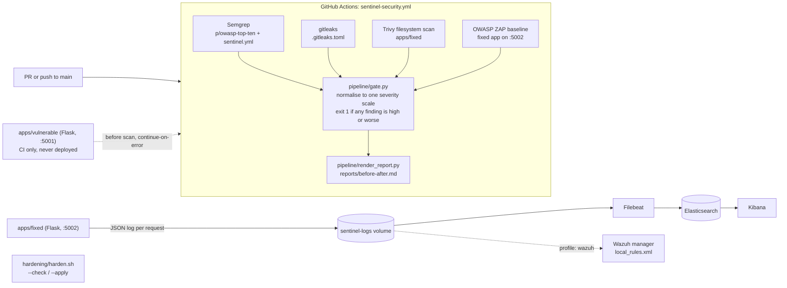

# Sentinel

[](https://github.com/iboondk/sentinel/actions/workflows/sentinel-security.yml)
[](https://github.com/iboondk/sentinel/actions/workflows/tests.yml)

Sentinel is a security and observability hardening kit. It runs the same scanners against an intentionally vulnerable Flask app and a fixed copy with the same API, gates pull requests on the results, renders a before/after report from real scanner output, and ships the logs of the fixed app into a local Elastic stack.

Everything runs locally. No cloud deploys, no paid services, no real credentials. Every secret-shaped value is fake and documented in [`.env.example`](.env.example).

License: MIT, Copyright (c) 2026 iboondk.

## Architecture



## What is in the repo

| Path | Purpose |
|---|---|
| `Makefile` | `make up`, `make down`, `make test`. |
| `apps/fixed/` | Fixed Flask app. Same API as the demo app with the flaws closed. See [`apps/fixed/FIXES.md`](apps/fixed/FIXES.md). |
| `apps/vulnerable/` | Intentionally vulnerable twin with the same API. **Never deploy it.** Each planted flaw is listed in [`apps/vulnerable/VULNERABILITIES.md`](apps/vulnerable/VULNERABILITIES.md). Scanned only by the informational "before" CI job. |
| `pipeline/gate.py` | Python stdlib gate. Parses Semgrep, Trivy, gitleaks and ZAP JSON, maps everything to `critical, high, medium, low, info`, writes `summary.json`, exits 1 at or above `--fail-on`. |
| `pipeline/render_report.py` | Renders the before/after Markdown report from two `summary.json` files. Every number comes from the input. |
| `pipeline/semgrep/sentinel.yml`, `pipeline/zap/rules.tsv` | Custom Semgrep rules and ZAP baseline rule config. |
| `.github/workflows/sentinel-security.yml` | Security pipeline: scanners, gate on the fixed app, informational scan of the vulnerable app, report job. |
| `.github/workflows/tests.yml` | Runs the pytest suite on push and pull request. |
| `observability/` | `docker-compose.yml` (Elasticsearch, Kibana, Filebeat, fixed app, optional Wazuh), Filebeat config, Wazuh rules, saved Kibana queries. |
| `hardening/` | Linux hardening checklist (`CHECKLIST.md`) and the idempotent `harden.sh --check/--apply` script. |
| `docs/threat-model.md` | STRIDE threat model of the demo app, pipeline and log stack. |
| `docs/ADR-*.md` | Architecture decision records for the main choices. |
| `reports/` | Report templates. `before/` and `after/` are filled by CI or by a local run with the scanners installed. |
| `tests/` | pytest suite, including synthetic scanner fixtures under `tests/fixtures/` (labelled as fixtures). |

## Quick start

Requirements: Docker with Compose v2. Elasticsearch uses a 512 MB JVM heap by default (`ES_JAVA_OPTS` in `.env`).

```bash
make up        # copies .env.example to observability/.env if missing, then docker compose up -d --build
```

That starts Elasticsearch, Kibana, Filebeat and the fixed app. `make down` stops it and `make test` runs the test suite.

Without `make`, one `docker compose` command does the same. The compose file lives in `observability/`, and every variable has a default in the file, so no `.env` copy is needed:

```bash
docker compose -f observability/docker-compose.yml up -d --build
```

To use your own tunables, copy `.env.example` to `observability/.env` first (`cp .env.example observability/.env`), then run the command above or `cd observability && docker compose up -d --build`.

Then open:

- Fixed app health: `http://127.0.0.1:5002/health` (returns `{"status":"ok","variant":"fixed"}`)
- Kibana: `http://127.0.0.1:5601`

Every published port is bound to `127.0.0.1`. Security is disabled in Elasticsearch for this local demo, so do not expose these ports on a shared host.

To add the Wazuh manager with the custom rules: `docker compose -f observability/docker-compose.yml --profile wazuh up -d`.

To stop: `make down`, or `docker compose down` inside `observability/` (add `-v` to delete the Elasticsearch and log volumes).

On a Linux host, Elasticsearch may refuse to start until the kernel setting is raised: `sudo sysctl -w vm.max_map_count=262144`.

## Running the tests

```bash
python3 -m venv .venv
.venv/bin/pip install -r requirements-dev.txt
.venv/bin/pytest -q
```

CI runs the same suite on Python 3.12 in [`tests.yml`](.github/workflows/tests.yml).

## Running the gate locally

The gate needs scanner output. Install the scanners (Semgrep, Trivy, gitleaks, OWASP ZAP) and run them against `apps/fixed`, then:

```bash
python3 pipeline/gate.py --target fixed \
  --semgrep semgrep.json --trivy trivy.json \
  --gitleaks gitleaks.json --zap zap.json \
  --fail-on high --summary-out reports/after/summary.json
```

Exit status is 1 when any finding is at or above `--fail-on`. Render the report with:

```bash
python3 pipeline/render_report.py \
  --before reports/before/summary.json \
  --after reports/after/summary.json \
  --template reports/templates/before-after.md.tmpl \
  --out reports/before-after.md
```

## Hardening script

```bash
sudo hardening/harden.sh --check            # report only (default)
sudo hardening/harden.sh --apply            # fix FAILs, back up changed files to *.sentinel.bak
```

Exit codes: `0` no FAIL remains, `1` a FAIL remains, `2` usage error. See [`hardening/CHECKLIST.md`](hardening/CHECKLIST.md) for each check and its manual verify command.

## Status and known gaps

- **Verified locally:** the pytest suite (129 tests). The tests check the apps, gate, report renderer, workflow and compose file structure, and the hardening script against fixture trees. The exploit tests for `apps/vulnerable` run under the dev dependencies (Flask 3.1.3), in the same process as `apps/fixed`. The Flask 2.2.2 pins in `apps/vulnerable/requirements.txt` are used only by the CI scan and the Docker image; the exploit tests have not been run against them.
- **CI status:** the `sentinel-security` workflow failed on GitHub in runs 38172856747 and 38136899692. Both scan jobs could not resolve `aquasecurity/trivy-action@0.28.0`, which is not a tag, so the `after` and `report` jobs did not run. The workflow now pins `v0.28.0` (commit `915b19bb`). A green run is not confirmed yet and needs a push to GitHub.
- **Not run locally:** `docker build` of `apps/fixed/Dockerfile`, `docker compose config` and `docker compose up`, Semgrep, Trivy, gitleaks, ZAP, actionlint. These tools are not installed on the development machine. Compose and workflow files are checked for YAML structure only until they run in an environment with the tools.
- **No numbers yet:** scanner counts appear only in `reports/before-after.md`, produced by a real CI run or a local run with the scanners installed. No green CI run exists yet, so the repo has no before/after numbers. This README contains no benchmark figures.

## Documents

- [`WRITEUP.md`](WRITEUP.md): problem, architecture, key decisions, results and next steps.
- [`DEMO.md`](DEMO.md): script for recording a GIF or Loom walkthrough.
- [`docs/threat-model.md`](docs/threat-model.md): STRIDE threat model.
- [`docs/ADR-0001-stdlib-only-gate.md`](docs/ADR-0001-stdlib-only-gate.md), [`docs/ADR-0002-twin-apps.md`](docs/ADR-0002-twin-apps.md), [`docs/ADR-0003-single-severity-scale.md`](docs/ADR-0003-single-severity-scale.md), [`docs/ADR-0004-elastic-local-only.md`](docs/ADR-0004-elastic-local-only.md), [`docs/ADR-0005-bash-3-compatible-hardening.md`](docs/ADR-0005-bash-3-compatible-hardening.md).

## Licence

MIT. See [`LICENSE`](LICENSE).
